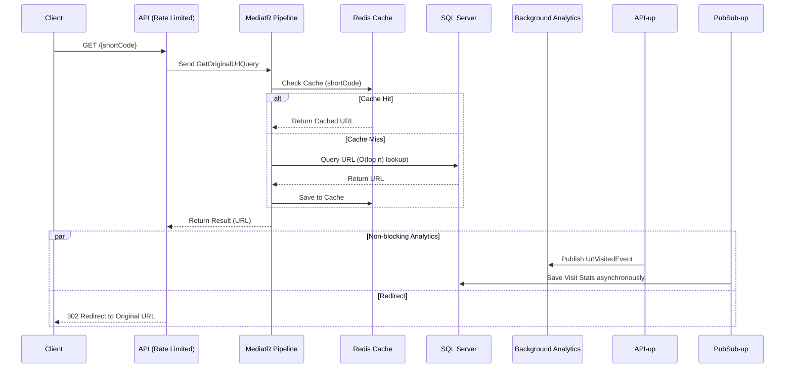

# High-Performance URL Shortener 🚀

An enterprise-ready URL shortening service engineered for high availability and sub-millisecond redirects. Built with **.NET 10**, implementing **Clean Architecture** and **CQRS**, and fully containerized using **Docker**.

## 🏗️ Tech Stack & Architecture
* **Framework:** .NET 10 (ASP.NET Core)
* **Architecture:** Clean Architecture, CQRS (MediatR)
* **Database & Caching:** SQL Server (EF Core), Redis Distributed Cache
* **Patterns:** Pipeline Behaviors, Pub/Sub (MediatR Notifications)
* **Infrastructure:** Docker, Docker Compose
* **Testing:** xUnit, FluentAssertions, Testcontainers

## ⚡ Key Features
* **Sub-Millisecond Redirects:** Bypasses database hits entirely by serving cached URLs from Redis via MediatR Pipeline Behaviors.
* **O(log n) Database Lookups:** Engineered with Unique Non-Clustered Indexes on short codes to prevent table scans.
* **Zero-Latency Analytics:** Decoupled redirect logic from visit tracking using the Pub/Sub pattern.
* **Resilience:** Secured with Fixed-Window Rate Limiting and actively monitored via Health Checks.
* **Integration Tested:** Verified against ephemeral SQL Server and Redis containers managed by Testcontainers.

## 📐 System Flow (Low-Level Design)

The following sequence diagram illustrates the robust caching and non-blocking analytics flow when a user requests a shortened URL:

## 🐳 Quick Start (Docker)

# Clone the repository
git clone [https://github.com/AhmedNasser/UrlShortener.git](https://github.com/AhmedNasser/UrlShortener.git)

# Spin up the API, SQL Server, and Redis
docker-compose up -d
